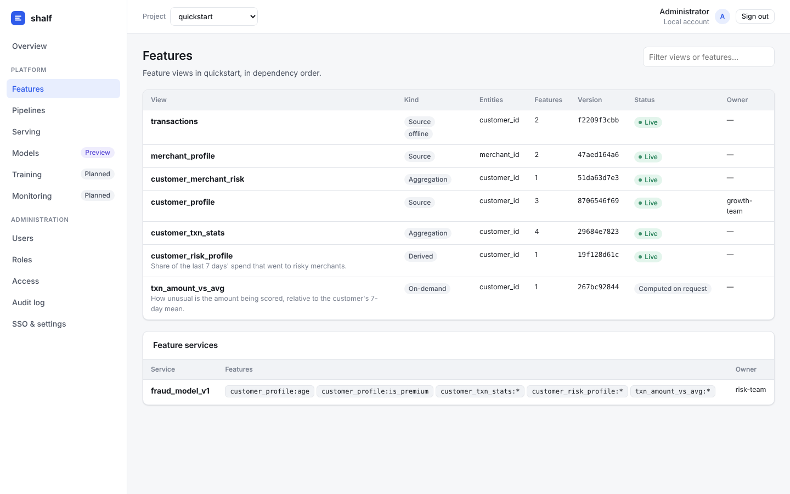
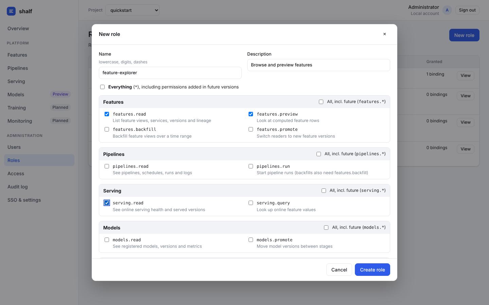
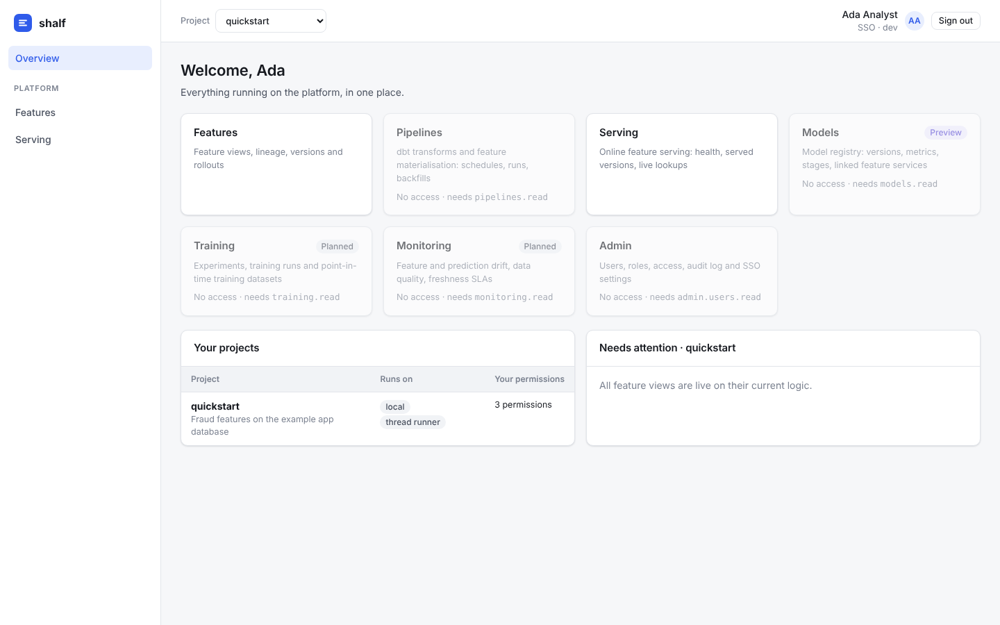

# Console: UI, SSO and RBAC

`services/console` is the platform's web UI and control-plane API: one
FastAPI service that also serves the React app (`services/console/web`).

```
browser ──▶ shalf-console ──┬─▶ project feature servers (/v1/admin, token-protected)
  (SPA)     (FastAPI)       ├─▶ Kubernetes API (pipeline CronJobs → Jobs, logs)
                            ├─▶ model registry
                            └─▶ console DB (users, roles, bindings, sessions, audit)
```



*Above: feature views of the quickstart project. Below: the role editor, and what an SSO user in the `analysts` group sees with the custom `feature-explorer` role (from `services/console/e2e/run_e2e.py`).*




## Modules

Each capability is a **console module**. It declares its permissions, its API
routes and a status: `ready`, `preview` or `planned`. The navigation and the
overview cards are built from `/api/modules`, so a module that ships (or a
third-party module registered under the `shalf.console.modules` entry point)
appears without touching the UI shell.

| Module | Status | Pages |
| --- | --- | --- |
| Features | ready | Views in dependency order, lineage, versions and rollout state, schema, computed-row preview, promote |
| Pipelines | ready | Pipelines with schedules, run now, backfill (range + promote), live run list, run logs including dbt output |
| Serving | ready | Health, served versions, pending rollouts, online lookup by feature service or features |
| Models | preview | Registered versions, metrics, linked feature service, stage changes |
| Training | planned | Placeholder; `training.read` already exists for preparing roles |
| Monitoring | planned | Placeholder; `monitoring.read` already exists |
| Admin | ready | Users, roles, access, audit log, SSO settings |

## Sign-in

- **Single sign-on (OIDC).** Authorization-code flow with PKCE, `state` and
  `nonce`. The ID token is verified against the provider's JWKS; only
  asymmetric algorithms are accepted, and issuer, audience and expiry are
  checked. Works with Okta, Microsoft Entra ID, Google, Keycloak, Auth0 and
  Dex. Several providers can be configured. SAML or LDAP directories are
  supported through an OIDC bridge (Dex or Keycloak).
- **Users** are created on first SSO sign-in. Their groups come from the
  `groups_claim` of the token, or from userinfo if it isn't in the token.
  `allowed_domains` restricts which email domains may sign in.
- **Local accounts** (scrypt-hashed passwords) are for bootstrap and
  development. Set `local_login: false` in production.
- **Sessions** are server-side, in an `httpOnly`, `SameSite=Lax` cookie. Every
  state-changing request must echo a CSRF token (double-submit). Responses
  carry a strict CSP and `X-Frame-Options: DENY`.
- **Disabling a user** ends their existing sessions immediately.

## RBAC

```
permission  features.promote            declared by a module
role        feature-reviewer            set of permission patterns: exact, module.*, or *
binding     group:ml-team → role @ scope    scope: "*" (global) or "project:<name>"
```

- **Built-in roles** cannot be edited: `admin` (`*`), `ml-engineer`,
  `data-scientist`, `viewer`. Admins create **custom roles** from any
  combination of permissions. `features.*` also covers permissions that future
  versions add to the module.
- **Bindings to SSO groups** follow group membership in the identity provider.
  Bindings to users work even before the user's first sign-in.
- **Project-scoped bindings** grant only that project's permissions. Admin
  permissions (`admin.*`) are global-only and never granted by project-scoped
  bindings.
- **Enforcement** happens in the API. The UI hides what you can't do, but the
  API checks every request. Some actions need several permissions: a backfill
  needs `pipelines.run` and `features.backfill`; promoting needs
  `features.promote`.
- **Guard rails:**
  - built-in roles are immutable
  - a role can't be deleted while bound
  - you can't revoke your own access management or disable yourself
  - `bootstrap_admins` in the config always get a global admin binding at
    start-up (break-glass)
- **Audit log:** every sign-in (including failures), role or binding change,
  user change, promotion, pipeline run and model stage change is recorded with
  the actor.

## Projects

| `type` | How the console reaches it | Pipeline runner |
| --- | --- | --- |
| `local` | Loads the project in-process from `path` | `thread` (background thread; dev and small installs) |
| `remote` | The project's feature servers: `/v1/admin/{plan,promote,preview,pipelines}` with `Authorization: Bearer $SHALF_ADMIN_TOKEN` | `kubernetes`: creates Jobs from the project's pipeline CronJobs, reads Job status and pod logs |

The feature server's admin API is disabled unless `SHALF_ADMIN_TOKEN` is set.
The platform's k8s base lets the console's ServiceAccount create Jobs in each
project namespace (`console-access.yaml`). The base also lets the console
reach the feature servers through the NetworkPolicies.

## Running it

```bash
make console-web            # build the UI (once, or after UI changes)
make quickstart             # create the example project's data
make console                # http://localhost:8090  admin@example.com / change-me-locally
make console-idp            # optional: a dev OIDC provider on :9555 ("Dev SSO" button)
make console-e2e            # browser test: SSO, custom role, group binding, RBAC in the UI
```

During UI development, `cd services/console/web && npm run dev` proxies
`/api` and `/auth` to the console on :8090.

Kubernetes: `deploy/k8s/console` (namespace `shalf-system`, two stateless
replicas, Postgres for the console database). Image:
`deploy/docker/console.Dockerfile`.

## Known gaps

- The model registry is the built-in `local` one; MLflow and similar plug in
  through `model_registry_registry`.
- No SCIM provisioning: users appear on first sign-in, and groups are read at
  sign-in (changes apply at the next sign-in).
- No rate limiting on local login; keep local login off in production or put
  the console behind a gateway that limits it.
- API tokens for automation are not implemented yet; scripts use the CLIs.
